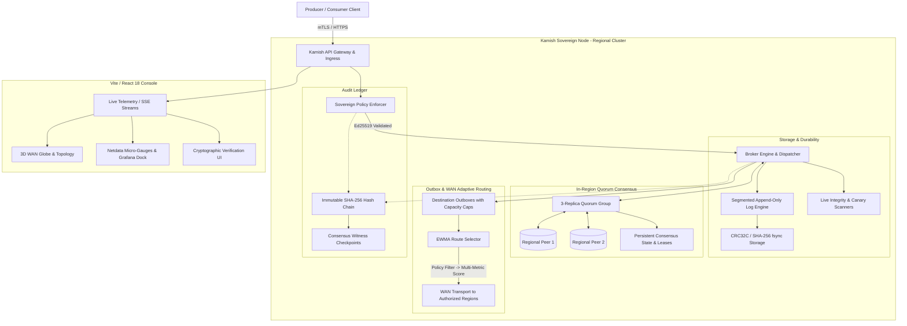

# KAMISH (神威)
### Sovereignty-Aware, WAN-Adaptive Multi-Region Distributed Event Streaming Platform

[]()
[]()
[]()
[]()
[](https://www.youtube.com/watch?v=o3i1Oi4AiYA)

---

## 📺 Project Resources
- **Project Video Demo**: [https://www.youtube.com/watch?v=o3i1Oi4AiYA](https://www.youtube.com/watch?v=o3i1Oi4AiYA)
- **GitHub Repository**: [https://github.com/abhinav29102005/kamish](https://github.com/abhinav29102005/kamish)

---

## 🌌 Overview

Modern enterprise event streaming architectures (Kafka, Pulsar) treat multi-region topology primarily as a problem of physical network latency and broker availability. However, global organizations are legally bound by strict data residency and sovereign jurisdiction mandates (EU GDPR, Swiss Banking Act, US FedRAMP, Indian DPDP).

**Kamish** is a distributed, multi-region event streaming platform engineered from the ground up to enforce **Cryptographic Sovereignty Invariants**. In Kamish:
- **One signed residency policy governs every byte movement, partition ownership claim, WAN replication hop, and failover route.**
- Data residency is verified mathematically before ingress ingestion and before egress network transmission.
- In-region 3-replica quorum groups guarantee durable append-only write commits and leader fencing.
- An immutable SHA-256 hash-chained audit ledger guarantees complete tamper-evident auditability without leaking plaintext payload data.

---

## 🏛️ System Architecture



---

## ⚡ Core Invariants & Architectural Capabilities

### 1. Cryptographically Signed Sovereignty Policies (`kamish-policy` & `kamish-enforce`)
- **Ed25519 Signed Contracts**: Partition placement, regional replication allowances, and classification tags are cryptographically signed.
- **Fail-Closed Policy Floor**: Brokers refuse older policy versions (anti-rollback). Key rotations enforce explicit transition windows.
- **Pre-Ingress Enforcement**: Any produce request targeted to an unauthorized region is rejected at the broker admission layer before hitting the disk.

### 2. Segmented Append-Only Storage Engine (`kamish-log`)
- **Strict Fsync & Checksums**: Zero data loss durability with per-record CRC32C and SHA-256 envelope headers.
- **Idempotent Producers**: Sequences and producer epochs prevent duplicated writes across network retries and failovers.
- **Crash Recovery**: Auto-heals and truncates torn writes or un-flushed segment tails cleanly on restart.

### 3. In-Region Quorum Consensus & Monotonic Fencing (`kamish-own`)
- **3-Replica Quorum Group**: Requires a strict majority ($N/2 + 1$) for durable partition commits before acknowledging producers under quorum ACK mode.
- **Monotonic Leases & Fencing**: Partition ownership is governed by monotonic generation epochs and leader leases with millisecond-accurate clock skew immunity.
- **Persistent Consensus State**: Persistent on-disk state machine (`consensus_state.json`) with atomic crash-recovery renames.

### 4. WAN-Adaptive Outbox Replication (`kamish-outbox`)
- **Offset-Preserving Replication**: Records are staged in destination outboxes with strictly bounded memory capacity and atomic reservations.
- **Queue-Depth Telemetry**: Exposes live `outbox_byte_size`, `outbox_pending_count`, and `oldest_entry_age_ms` for real-time backpressure monitoring.

### 5. Multi-Factor Sovereign Route Scoring (`kamish-route`)
- **Hard Policy Filter First**: Paths that violate regulatory residency rules are pruned immediately regardless of latency or cost.
- **EWMA Metric Smoothing**: Candidate routes are dynamically scored over smoothed RTT, packet loss, queue congestion, financial egress cost, and regulatory sovereign risk.
- **Circuit Breaking**: Automatic trip and failover under degraded WAN links with bounded exponential retry backoff.

### 6. Tamper-Evident SHA-256 Audit Ledger (`kamish-audit` & `kamish-checkers`)
- **Payload-Free Auditability**: Ingress and egress decisions are hashed into an immutable cryptographic chain (`H_n = SHA256(H_{n-1} || Entry_n)`).
- **Consensus Anchoring**: Periodically anchored against distributed consensus checkpoints, distinguishing committed audit histories from unanchored tails.
- **Active Canary Scanners**: Background verifiers scan segment boundaries and test data integrity in real time.

### 7. Observability Console & Sovereign 3D Visualizer (`frontend`)
- **Interactive 3D WAN Globe**: Three.js visualization of cross-region links, traffic health, and active partition leases.
- **Netdata & Grafana Integration**: Real-time micro-metrics and live telemetry docks.
- **Animated 3D Kamish Dragon**: Real-time 3D sovereign guardian mascot with complete accessibility compliance (`prefers-reduced-motion` detection, SVG fallback, and full ARIA semantics).

---

## 📦 Workspace Repository Structure

```
kamish/
├── cmd/
│   ├── kamish-broker/     # Regional TCP broker daemon, quorum consensus manager, Prometheus metrics
│   ├── kamish-gateway/    # Axum HTTP/WebSocket API gateway, security headers, CSRF, auth, checkers
│   ├── kamish-agent/      # Sovereign edge agent and local node supervisor
│   └── kamish-ctl/        # Administrative CLI for policy signing, cluster inspection, and partition control
├── crates/
│   ├── kamish-log/        # Segmented append-only log engine, CRC32C checksums, record envelopes
│   ├── kamish-policy/     # Ed25519 policy structures, canonical serialization, key rotation
│   ├── kamish-enforce/    # Ingress/egress residency enforcement rules and tenant isolation
│   ├── kamish-own/        # In-region 3-replica quorum, partition ownership, monotonic lease timers
│   ├── kamish-meta/       # Metadata authority, lease grants, audit checkpoints, CAS operations
│   ├── kamish-outbox/     # WAN destination outboxes, capacity management, age metrics
│   ├── kamish-route/      # WAN routing algorithms, EWMA path scoring, circuit breakers
│   ├── kamish-audit/      # Cryptographic SHA-256 audit ledger, chain verification, anchor boundaries
│   ├── kamish-checkers/   # Segment integrity checkers, history scanners, canary validation
│   └── kamish-client/     # High-performance Rust client SDK
├── frontend/              # React 18 + Vite + Three.js sovereign observability console
├── packages/              # TypeScript / Node.js client SDK
├── early_research/        # Mathematical proofs, baseline probes, and anomaly test harnesses
├── audit/                 # Verification reports, quality gate logs, and evidence artifacts
└── decisions.md           # Architecture Decision Records (ADRs 001–005)
```

---

## 🚀 Quickstart Guide

### Prerequisites
- **Rust Toolchain**: `stable` (edition 2021 / 2024 compatible)
- **Node.js**: `v18.x` or higher and `npm`

### 1. Clone & Build
```bash
git clone https://github.com/abhinav29102005/kamish.git
cd kamish
cargo build --workspace --all-features
```

### 2. Run Comprehensive Test Suite
```bash
# Run all workspace unit, integration, and scenario tests
cargo test --workspace --all-features

# Run probe verification tests
cargo test --manifest-path early_research/probes/Cargo.toml --lib
cargo test --manifest-path early_research/probes/Cargo.toml --test remaining_gaps
```

### 3. Launch Regional Broker & API Gateway
```bash
# Launch the API gateway with local broker support
cargo run -p kamish-gateway -- --port 8080 --dev
```

### 4. Launch the Observability Console
```bash
cd frontend
npm install
npm test
npm run dev
```
Open your browser at `http://localhost:5173` to explore the sovereign observability console, live audit chain verification, and 3D WAN topology.

---

## 🛡️ Security & Quality Standards

- **Strict Clippy Compliance**: Built and checked with `cargo clippy --workspace --all-targets --all-features -- -D warnings` with **zero `#[allow]` exemptions**.
- **Formatted**: Strictly verified with `cargo fmt --check`.
- **Security Headers**: HSTS, Content-Security-Policy (CSP), X-Frame-Options: DENY, X-Content-Type-Options: nosniff.
- **Session Protection**: HTTPS-enforced `Secure; HttpOnly; SameSite=Strict` cookies with automatic session rotation.
- **Tenant Isolation**: RBAC roles and Tenant IDs bound at the kernel dispatch layer to prevent unauthorized cross-tenant partition access.

---

## 📄 License & Attribution

Kamish is dual-licensed under the **MIT License** and the **Apache License 2.0**.  
3D assets and graphics are released under **Creative Commons Zero (CC0 1.0 Universal) / MIT Dual License** (see [`frontend/public/models/LICENSE.md`](frontend/public/models/LICENSE.md)).
