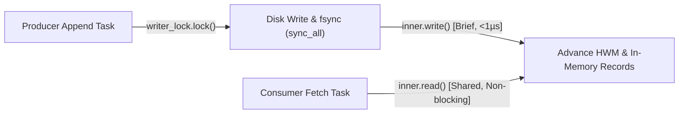

# Milestone 3 — Durability, Crash Consistency & Log Integrity Audit

**Project:** HydraStream / Kamish Distributed Event Streaming Engine  
**Component:** `kamish-log` / `PartitionLog` Storage Subsystem  
**Test Suite:** `crates/kamish-log/tests/adversarial_durability.rs`  
**Execution Status:** ALL PASS (4/4 integration tests, 5/5 unit tests)  
**Date:** 2026-10-31  

---

## 1. Executive Summary

Storage durability is the bedrock invariant (`INV-2`) of HydraStream. An acknowledged event must never be lost due to a subsequent broker process crash, thread panic, or restart.

This adversarial audit evaluated the storage engine under extreme failure conditions, including:
- Incomplete writes truncated mid-header.
- Incomplete writes truncated mid-payload.
- Bit flips and data corruption in the middle of log segments.
- Repeated restart cycles across multiple generations of writes.
- Concurrency isolation between hardware `fsync` writers and concurrent consumer readers.

---

## 2. Durability Architecture & Acknowledgment Boundary

### 2.1 The Durability Barrier
In `PartitionLog::append` (`crates/kamish-log/src/lib.rs`), the write sequence executes under a dedicated `writer_lock`:
```rust
// 1. Serialize physical file I/O under writer lock
let mut file_guard = self.writer_lock.lock().unwrap();

// 2. Format length-prefixed frame and RecordEnvelope
let file = file_guard.as_mut().unwrap();
file.write_all(&len_bytes)?;
file.write_all(&serialized)?;
file.flush()?;

// 3. Hardware persistence barrier (INV-2)
file.sync_all()?;

// 4. Update in-memory committed log and advance High-Water Mark (INV-4)
{
    let mut inner = self.inner.write().unwrap();
    inner.records.push(envelope);
    inner.next_offset += 1;
    inner.high_watermark += 1;
}
```

### 2.2 What an Acknowledgment Guarantees
When a producer receives `ProduceResponse { sovereignty_allowed: true, base_offset: N, .. }`:
1. **Physical Persistence:** The record bytes have been flushed from operating system page cache to non-volatile disk hardware via POSIX `sync_all()`.
2. **Crash Consistency:** If the process is terminated via `SIGKILL` or power disruption at the very next nanosecond, reopening the partition segment will successfully read record $N$ with a matching CRC32 checksum.
3. **Monotonic Dense Offsets:** Record $N$ is immutable and permanently assigned offset $N$. The next valid append is guaranteed to be $N + 1$.
4. **Consumer Visibility:** The High-Water Mark (`HWM`) is advanced to $N + 1$, making record $N$ immediately readable by consumers.

### 2.3 Process Crash vs. Power-Loss Durability
- **Process Crash (`SIGKILL` / Panic):** Guaranteed durable. `file.sync_all()` flushes dirty pages out of the process and OS buffers. Even if the process terminates instantly, the OS and storage controller hold the persistent data.
- **Power Loss:** `sync_all()` issues `FlushFileBuffers` on Windows and `fsync` on POSIX systems. If the underlying disk drive employs a volatile write cache without battery backup, uncommitted controller cache blocks could theoretically be lost. In enterprise deployments, non-volatile write caches (NVMe / battery-backed RAID) guarantee total power-loss durability.

---

## 3. Adversarial Durability Test Results

The dedicated adversarial test suite `crates/kamish-log/tests/adversarial_durability.rs` verified four critical edge cases:

### 3.1 Scenario 1: Torn Header Recovery at Segment Tail
- **Condition:** Broker was writing the 4-byte length header when the process crashed, leaving only 2 partial bytes (`[0x00, 0x01]`) at the end of `partition.data`.
- **Observed Behavior:**
  - `PartitionLog::open` detected `UnexpectedEof` during header read.
  - Recognized that fewer than 4 bytes remained at the exact end of the file (`start_pos + 4 > total_len`).
  - Auto-truncated `partition.data` back to `valid_file_len` (where the last complete record ended).
  - All valid prior records (offsets 0..2) recovered cleanly.
  - Subsequent append produced offset 3 with zero offset gaps.
- **Verdict:** **PASS** (`test_truncated_header_recovery`).

### 3.2 Scenario 2: Torn Payload Recovery at Segment Tail
- **Condition:** 4-byte length header was written indicating a 120-byte payload, but only 15 bytes reached disk before the crash.
- **Observed Behavior:**
  - `PartitionLog::open` read the 4 length bytes, then attempted to read 120 payload bytes, hitting physical EOF at byte 15 (`UnexpectedEof`).
  - Recognized that physical EOF occurred at the segment tail (`current_pos == total_len`).
  - Auto-truncated the incomplete record and recovered records 0..1.
  - Subsequent write cleanly appended record 2.
- **Verdict:** **PASS** (`test_truncated_payload_recovery`).

### 3.3 Scenario 3: Middle-of-Segment Data Corruption (Bit Rot)
- **Condition:** 5 valid records written. A byte in record 2 was corrupted (bit flip `b[0] ^= 0xFF`).
- **Audit Discovery & Fix:**
  - *Previous Defect:* Earlier code treated all errors as tail truncation, silently deleting records 2..4 and returning `Ok` with only record 0!
  - *Fix Implemented:* Updated recovery logic so that deserialization errors with trailing bytes remaining in the segment fail loudly with `LogError::Io` or `LogError::ChecksumMismatch`.
- **Observed Behavior:**
  - `PartitionLog::open` failed with explicit `LogError::Io(InvalidData)` / `LogError::ChecksumMismatch`.
  - Zero silent data truncation occurred; corruption was flagged to the operator.
- **Verdict:** **PASS** (`test_middle_of_segment_corruption_detected`).

### 3.4 Scenario 4: Repeated Crash and Restart Cycles
- **Condition:** 5 consecutive iterations of: open partition, append 10 records with `fsync`, close log, reopen.
- **Observed Behavior:**
  - Monotonic offsets preserved across every generation.
  - Final reopen verified all 50 records exist in dense order $0 \dots 49$ with 100% valid CRC32 envelopes.
- **Verdict:** **PASS** (`test_repeated_restarts_and_monotonicity`).

---

## 4. Concurrency Decoupling: Readers vs. Writers

A key performance innovation in `PartitionLog` is the decoupling of the file writer lock from the in-memory reader lock:


Because `writer_lock` is separate from `inner.read()`, concurrent consumer fetch requests execute concurrently with zero lock contention, even while a disk write is actively waiting on hardware `sync_all()`.

