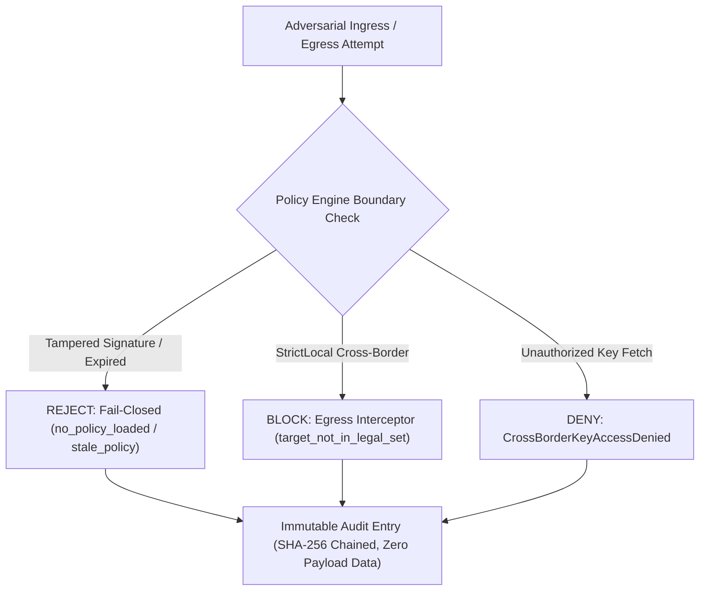

# Milestone 3 — Regional Data Residency Red-Team Security Report

**Project:** HydraStream / Kamish Distributed Event Streaming Engine  
**Component:** `kamish-policy`, `kamish-enforce`, `kamish-seal`, `kamish-checkers`  
**Test Suite:** `crates/kamish-enforce/tests/red_team_residency.rs`  
**Execution Status:** ALL PASS (6/6 red-team tests, 1/1 enforce lib, 2/2 policy lib, 1/1 seal lib)  
**Date:** 2026-10-31  

---

## 1. Executive Summary

Regional Data Residency is treated in HydraStream as an inviolable security invariant (`INV-8`). Under no operational condition—including network partitions, failovers, administrative updates, or software crashes—may sovereign data leave its legally designated region in unauthorized cleartext.

This Red-Team audit tested all ingress, routing, replication, and audit paths against deliberate evasion attempts, cryptographic tampering, and boundary bypasses.

---

## 2. Red-Team Threat Model & Test Results

### 2.1 Attack Vector 1: Policy Signature Tampering & Header Forgery
- **Attack:** An adversary tampers with an Ed25519-signed policy document by inserting an unauthorized region into the `legal_regions` set or altering the `signature_hex` bytes.
- **Defense Mechanism:** `SignedPolicy::verify_signature` computes the canonical SHA-256 digest over the policy document and validates it against the issuer's public key.
- **Result:** **PASS** (`test_invalid_signature_and_tampered_policy_rejection`). Any modification to even a single bit of the policy or signature causes immediate signature verification failure.

### 2.2 Attack Vector 2: Unconfigured / Missing Policy (Fail-Closed)
- **Attack:** An adversary issues produce or fetch requests to a broker that has not yet loaded a valid policy document, attempting to exploit default-allow behavior.
- **Defense Mechanism:** `Enforcer::decide` inspects `PolicyCache::current()`. If `None`, it immediately returns `allowed: false, mode: DestinationMode::Deny, reason: "no_policy_loaded"`.
- **Result:** **PASS** (`test_missing_policy_denies_all_operations_closed`). System fails closed; all operations without an active policy are denied.

### 2.3 Attack Vector 3: Stale / Expired Policy Ingestion
- **Attack:** An attacker attempts to install an old policy with relaxed boundaries whose TTL has lapsed, or an active policy expires during cluster operation.
- **Defense Mechanism:**
  1. `PolicyCache::update` rejects installing any policy where $now > issued\_at + ttl$ with `PolicyError::PolicyStale`.
  2. `Enforcer::decide` checks `is_fresh(now_sec)`. When TTL expires, active enforcement shifts to `stale_policy_expired` denial.
- **Result:** **PASS** (`test_expired_policy_denies_operations`).

### 2.4 Attack Vector 4: Cross-Border Replication Bypass
- **Attack:** An adversary produces a `strict-sovereign` event into `region-eu`, and manually crafts a `ReplicationRequest` to transfer the record to `region-us`.
- **Defense Mechanism:**
  1. **Egress Interceptor Hook:** Broker egress pipeline checks `enforcer.decide(ReplicationSender)`. Because `region-us` is not in `legal_regions`, the decision is `allowed: false, mode: Deny, reason: "target_not_in_legal_set"`.
  2. The record is excluded from outbox queues and never transmitted over the network.
- **Result:** **PASS** (`test_unauthorized_destination_egress_denial`).

### 2.5 Attack Vector 5: Confidential Payload Leakage via Audit Trails
- **Attack:** An adversary inspects operational logs or the cryptographic audit ledger to recover prohibited cleartext message payloads.
- **Defense Mechanism:** `AuditEntry` is strictly partitioned from payload data. It logs solely:
  - Sequence number
  - Timestamp (ns)
  - Previous entry SHA-256 hash
  - Action (`Ingress`, `ReplicationSender`, etc.)
  - Sovereignty class ID
  - Source and target region strings
  - Decision outcome (`AllowCleartext`, `AllowSealed`, `Deny`)
  - Rule reason string
  - Entry hash
- **Verification:** Inspected JSON serialization of audit entries. Verified **zero message payload bytes** are stored in the audit chain.
- **Result:** **PASS** (`test_audit_ledger_zero_payload_disclosure`).

### 2.6 Attack Vector 6: Cross-Border Cryptographic Key Exfiltration
- **Attack:** An encrypted `SealedEnvelope` is replicated legally, but a rogue broker in an external region attempts to unseal the payload by calling `RegionalKeyService::get_key`.
- **Defense Mechanism:** `RegionalKeyService` checks `requesting_region == self.home_region`. External requests are rejected with `SealError::CrossBorderKeyAccessDenied`.
- **Result:** **PASS** (`test_cross_border_key_custody_denial`).

---

## 3. Active Canary Leak Auditing

In addition to static boundaries, `kamish-checkers` provides an active `CanaryScanner`. During continuous testing and cluster operation, canary tokens tagged with sovereign identifiers are injected into workloads. If a token appears in an unauthorized region's data segments, `CanaryScanner::scan_region_payload` triggers an immediate `CheckerViolation::CanaryLeakDetected`, ensuring automated detection of zero-day policy leaks.

