# Hydra Stream — Project Documentation

> **Hydra Stream** is a Kafka-style distributed event broker in which data stays inside its legally permitted regions, replication routes around slow or degraded links, and a regional outage degrades the service per data class instead of freezing it.

**Document status:** Draft v0.1 · 31 Oct 2026 · Prototype scope, not a compliance product.

**Implementation/contract update, 1 Nov 2026:** Architecture diagrams and sketches
below are design intent. [worktillnow.md](worktillnow.md) records implementation
scope. [docs/CONTRACT.md](docs/CONTRACT.md) proposes explicit modes, ACK durability,
watermark identity, audit witnessing and revocation semantics; it awaits approval.
Requirement and invariant numbers remain unchanged. In particular, the proposed
initial strict authority mode would leave NFR-01 pending, not satisfy it.

---

## How This Document Is Organised

| Part | Title | Answers the question |
| --- | --- | --- |
| [Part 1](#part-1--foundations) | Foundations | *What are we building, why, and what exactly are we promising?* |
| [Part 2](#part-2--architecture-and-data-flow) | Architecture and Data Flow | *How is the system structured and how does data move?* |
| [Part 3](#part-3--core-logic-and-implementation) | Core Logic and Implementation | *How does each critical behaviour work, step by step?* |
| [Part 4](#part-4--validation-risk-and-delivery) | Validation, Risk and Delivery | *How do we prove it, what can go wrong, and how do we ship it?* |

## Table of Contents

- [Part 1 — Foundations](#part-1--foundations)
  - [1.1 Purpose and Research Question](#11-purpose-and-research-question)
  - [1.2 Scope and Non-Goals](#12-scope-and-non-goals)
  - [1.3 Semantics We Commit To](#13-semantics-we-commit-to)
  - [1.4 Requirements](#14-requirements)
  - [1.5 Build, Reuse and Tiers](#15-build-reuse-and-tiers)
  - [1.6 What Is Different (Novelty)](#16-what-is-different-novelty)
  - [1.7 Glossary](#17-glossary)
- [Part 2 — Architecture and Data Flow](#part-2--architecture-and-data-flow)
  - [2.1 System Context](#21-system-context)
  - [2.2 Federated Regional Architecture](#22-federated-regional-architecture)
  - [2.3 Deployment View](#23-deployment-view)
  - [2.4 Policy Data Model](#24-policy-data-model)
  - [2.5 Metadata Entity-Relationship Model](#25-metadata-entity-relationship-model)
  - [2.6 Enforcement Points Map](#26-enforcement-points-map)
  - [2.7 Data Flow Diagrams (Levels 0 to 3)](#27-data-flow-diagrams-levels-0-to-3)
- [Part 3 — Core Logic and Implementation](#part-3--core-logic-and-implementation)
  - [3.1 Sequence Diagrams](#31-sequence-diagrams)
  - [3.2 Logic Flowcharts](#32-logic-flowcharts)
  - [3.3 State Machines](#33-state-machines)
  - [3.4 Reference Pseudocode](#34-reference-pseudocode)
  - [3.5 API and Record Envelope](#35-api-and-record-envelope)
  - [3.6 Repository and Module Layout](#36-repository-and-module-layout)
- [Part 4 — Validation, Risk and Delivery](#part-4--validation-risk-and-delivery)
  - [4.1 Test Bed](#41-test-bed)
  - [4.2 Scenario Matrix](#42-scenario-matrix)
  - [4.3 Failure Matrix](#43-failure-matrix)
  - [4.4 Metrics and Method](#44-metrics-and-method)
  - [4.5 Baselines and Fairness Rules](#45-baselines-and-fairness-rules)
  - [4.6 Hypotheses](#46-hypotheses)
  - [4.7 Threat Model and Risks](#47-threat-model-and-risks)
  - [4.8 Delivery Plan](#48-delivery-plan)
  - [4.9 Demo Script](#49-demo-script)
  - [4.10 Open Questions and Assumptions](#410-open-questions-and-assumptions)
  - [4.11 Claims Checklist](#411-claims-checklist)
  - [4.12 References](#412-references)

---

# Part 1 — Foundations

## 1.1 Purpose and Research Question

Hydra Stream exists to test one question:

> How can a multi-region event-streaming platform preserve strict data-residency constraints while adapting to WAN degradation and regional failures, without violating durability, ordering, authorization, or recovery guarantees?

Kafka with MirrorMaker 2 and Apache Pulsar already provide geo-replication. Hydra Stream is therefore **not** "Kafka with replication". Its contribution is the sovereignty-aware control and data-plane behaviour that sits on top of a standard log.

Three requirements from the challenge, treated as separate and interacting:

1. **Residency.** Data must remain within its legally permitted region.
2. **Adaptivity.** Messages should route around slow or degraded links.
3. **Survivability.** The system survives a regional outage without freezing the entire service.

## 1.2 Scope and Non-Goals

| In scope | Out of scope |
| --- | --- |
| Three emulated logical regions | Real multi-cloud deployment |
| Per-class residency policy, signed and versioned | Legal compliance certification or legal advice |
| Broker-side enforcement at every persistence and send point | Defence against a compromised broker already holding cleartext |
| Policy-constrained adaptive replication with a durable outbox | A new congestion-control algorithm |
| Epoch-based fencing and policy-gated failover | Exactly-once delivery or transactions |
| Canary-based evidence and reproducible test runs | Cryptographic proof of physical location |
| Comparison against Kafka + MirrorMaker 2 and Pulsar geo-replication | Production workload identity and HSM key management |

## 1.3 Semantics We Commit To

| Topic | Commitment | Not claimed |
| --- | --- | --- |
| Delivery | At-least-once to consumers; producer retries deduplicated by session and sequence | Exactly-once, global or transactional |
| Ordering | Per partition, within one owner epoch | Global or per-topic order |
| Duplicates | After failover, bounded by the checkpoint interval | Zero duplicates |
| Durability | Per class acknowledgment mode (see below) | Zero loss during any partition |
| Residency | Zero unauthorized replication **in the tested scenarios and scanned locations** | A universal or legal guarantee |
| Location | Taken from configured infrastructure labels | Proven physical location |

**Acknowledgment modes** (declared per class):

| Mode | Acknowledged when | Failure trade-off |
| --- | --- | --- |
| `local-quorum` | Majority of in-region replicas have fsynced | Acknowledged but unreplicated records can be lost on whole-region loss, bounded by replication lag |
| `legal-set-sync(k)` | Local quorum **and** `k` replicas in the legal set are durable | No loss for acknowledged records, but higher latency and writes block when `k` replicas are unreachable |

## 1.4 Requirements

### 1.4.1 Functional Requirements

| ID | Requirement | Tier |
| --- | --- | --- |
| FR-01 | Create a topic bound to a data class | P0 |
| FR-02 | Produce batches with idempotent producer sessions | P0 |
| FR-03 | Fetch records in offset order up to the committed high-water mark | P0 |
| FR-04 | Evaluate one signed policy decision before every persist, send, export and fetch | P0 |
| FR-05 | Replicate in mirror mode with offsets preserved | P0 |
| FR-06 | Queue replication in a bounded durable outbox and resume from a durable watermark | P0 |
| FR-07 | Maintain per-partition `(owner_region, epoch)` and fence stale writers | P0 |
| FR-08 | Promote a new owner only if policy lists it as eligible | P0 |
| FR-09 | Apply per-class degradation when no legal alternate exists | P0 |
| FR-10 | Provide canary scanner and invariant checkers | P0 |
| FR-11 | Sealed-only (ciphertext) destination mode | P1 |
| FR-12 | Transit-allowed relay hops for ciphertext only | P1 |
| FR-13 | Hash-chained, region-local decision log | P1 |
| FR-14 | Derive mode with offset lineage | P2 |

### 1.4.2 Non-Functional Requirements

| ID | Requirement | Verification |
| --- | --- | --- |
| NFR-01 | Control plane is **off the write path**; pinned classes keep accepting local writes if it is lost | Control-plane outage scenario |
| NFR-02 | Fail closed on unknown, unsigned, rolled-back or stale policy for restricted classes | Tampered, replayed and expired policy tests |
| NFR-03 | Memory is bounded; at the outbox disk bound the class backpressure rule applies | Long-outage scenario with memory monitoring |
| NFR-04 | Route changes require smoothed, windowed evidence | Oscillation-rate metric |
| NFR-05 | Every reported number links to a run, configuration and date | Results log |
| NFR-06 | All inter-component traffic uses mutually authenticated TLS 1.3 | Plaintext scan, unknown-client rejection |

## 1.5 Build, Reuse and Tiers

Tiers: **P0** committed · **P1** committed if time allows · **P2** cut first, and removed from pitch material if cut.

| # | Component | Build or reuse | Tier |
| --- | --- | --- | --- |
| 1 | Segmented append-only log | Build (small) | P0 |
| 2 | In-region replication | Build on Raft or quorum-fsync design | P0 |
| 3 | Producer and consumer API (gRPC) | Build | P0 |
| 4 | Idempotent producers and offsets | Build | P0 |
| 5 | Mirror-mode replication between regions | Build | P0 |
| 6 | Durable outbox and resumable transfer | Build | P0 |
| 7 | Metadata quorum | Reuse a Raft library | P0 |
| 8 | Transport security and identity | Reuse TLS 1.3 and standard certificates | P0 |
| 9 | Link measurement | Build (small) | P1 |
| 10 | Region emulation and fault injection | Reuse Linux tools and containers | P0 |
| 11 | Checkers and metrics | Build checkers, reuse metrics libraries | P0 |
| 12 | Baselines (Kafka + MirrorMaker 2, Pulsar) | Deploy as documented | P0 |
| 13 | Policy signing and verification | Reuse standard signature primitives | P0 |

> **Provisional.** If organizers allow building on Kafka or Pulsar, components 1 to 4 could be replaced by an existing broker, at the cost of weaker control over the storage and send path the enforcement library depends on.

## 1.6 What Is Different (Novelty)

The research hypothesis is **one signed class policy applied consistently across
admission, storage, replication, replay, recovery and ownership change**, evaluated
with scope-specific evidence. It is not a claim that any one of those mechanisms
is new or that the complete lifecycle is already implemented.

Pulsar enforces tenant/namespace allowed-cluster restrictions server-side;
producers cannot override them. Ciphertext-only storage through client encryption
is also existing prior art. Topic-level replication/failover, fencing, hash chains
and canaries are established techniques. See S1–S7 in the
[dated source review](early_research/SOURCES_AND_PRIOR_ART.md). Compare against
those real controls, not an artificially unrestricted producer-list baseline.

The D identifiers below retain their original design references. They identify
parts of the proposed integrated contract, not independently established novelty.
Everything in [section 1.5](#15-build-reuse-and-tiers) remains standard engineering.

| # | Proposed integration | Tier | Evidence required / current boundary |
| --- | --- | --- | --- |
| D1 | Same signed policy at persistence, movement and lifecycle boundaries | P0 | Full-path canary/history tests with positive controls; current checks cover selected local paths |
| D2 | Per-destination mode plus key/restore policy | P1 | Secure ciphertext/restore evidence; sealed runtime remains disabled and outside current work |
| D3 | Explicit transit policy | P1 | Actual permitted/denied relay evidence; relay implementation outside current work |
| D4 | Class-specific durability, ownership and degradation contract | P0 | Independent failure histories per class; not established by enum variants |
| D5 | Authoritative owner fencing gated by the same policy | P0 | Quorum/restart/partition tests; independent-owner probe currently fails |
| D6 | Reproducible lifecycle evidence with stated scope | P0 / P1 | Real-byte canary/history checks and independent audit anchors; completeness probe currently fails |
| D7 | Derived stream lineage | P2 | Outside current work; not an implemented capability |

**Explicitly not new:** offset-preserving mirror replication, producer idempotence, per-partition ordering, majority-fsync replication, Raft metadata, TLS 1.3, standard congestion control, and hysteresis or circuit-breaker route stability (we only apply them inside the policy-permitted graph).

**Research statement, pending implementation and comparative evidence:**

> Kamish investigates whether one recoverable signed class-policy contract across
> admission, storage, replication, replay, recovery and ownership change improves
> the measured behavior of a broker under specified failures. Current results
> establish selected local mechanisms. Comparison with equivalently configured,
> version-pinned Kafka/MirrorMaker 2 and Pulsar remains future experimental work.

**Comparison basis.** Statements about other systems come from public documentation and vendor material reviewed in a targeted, not exhaustive, review. Word them as "in the documentation we reviewed", never "nobody does this", and re-check before submission.

## 1.7 Glossary

| Term | Meaning |
| --- | --- |
| **Class** | A data classification that carries a policy (legal set, mode, ack mode, failover candidates) |
| **Legal set** | Regions where a class may be stored or processed |
| **Epoch** | Monotonically increasing ownership number per partition, used as a fencing token |
| **Lease** | Time-limited ownership right; an owner that cannot renew stops acknowledging writes |
| **Outbox** | Bounded, durable, per-destination replication queue |
| **Watermark** | Highest offset a receiver has durably applied |
| **Sealed copy** | Ciphertext-only replica whose key stays in the key-residency region |
| **Transit** | A relay hop through a third region, permitted only for ciphertext |
| **Canary** | Unique synthetic record per class used to detect leaks |
| **RPO / RTO** | Recovery point / recovery time objective, measured per scenario |
| **Quarantine segment** | Local, never-replicated store for a recovered old owner's superseded log suffix |
| **Fail closed** | Deny the operation when policy is unknown, invalid or stale |

---

# Part 2 — Architecture and Data Flow

## 2.1 System Context

Hydra Stream is a federated set of autonomous regions plus a small, payload-free global control plane.

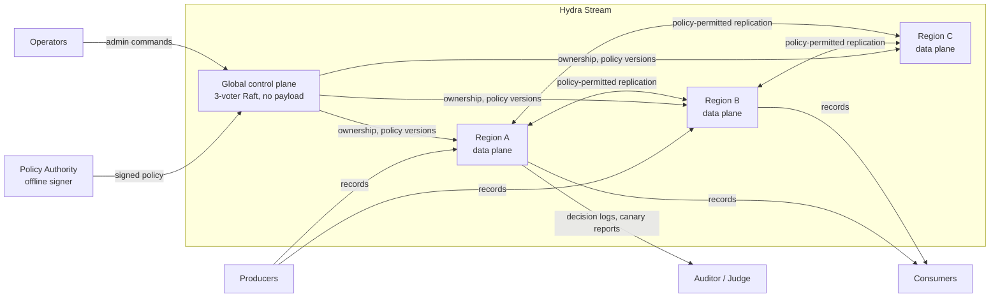

## 2.2 Federated Regional Architecture

Each region is autonomous. The control plane distributes **permitted metadata and replication intent only**.

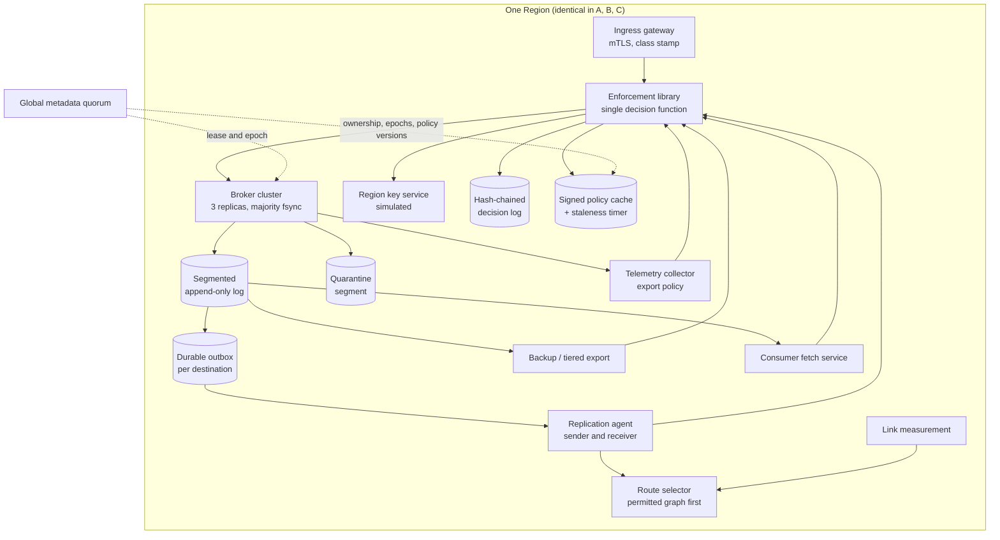

**Design rules**

1. The enforcement library is linked into ingress, broker, sender, receiver, backup/export, fetch, telemetry export and admin tools. No component persists or sends payload without calling it.
2. The metadata quorum holds ownership, policy versions and membership. It holds **no payload** and is **not on the ordinary write path**.
3. The route selector filters to the policy-permitted graph first, then optimises inside it. Policy is a hard constraint, never a score.

## 2.3 Deployment View

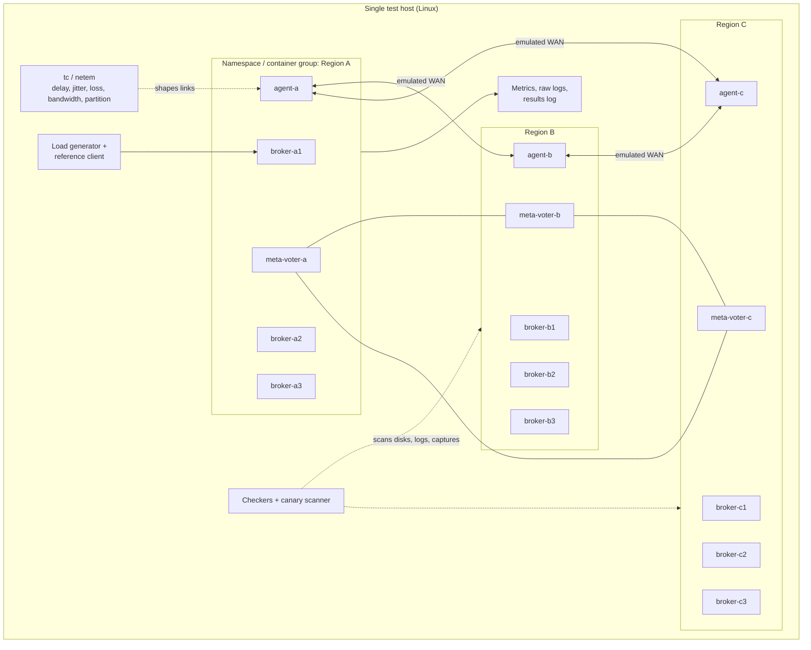

> **Limit.** A single-host emulation approximates real wide-area behaviour. State the hardware, calibrate the emulator (achieved versus configured delay and bandwidth), and treat **ratios between configurations** as more meaningful than absolute numbers.

## 2.4 Policy Data Model

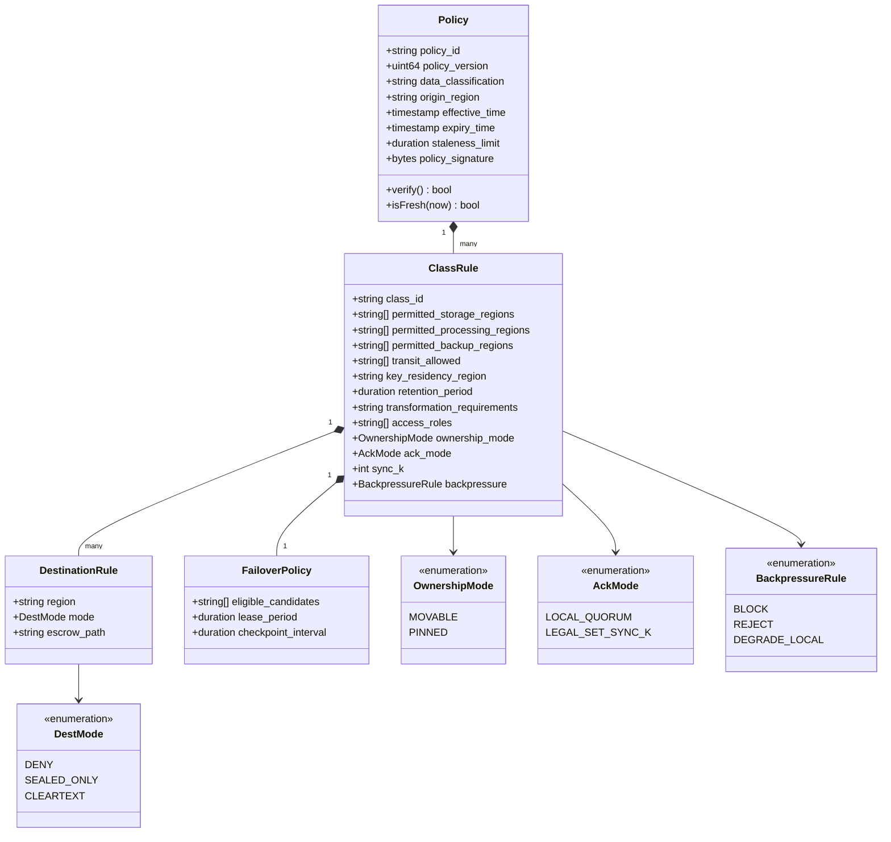

**Policy versioning rules**

- Versions increase monotonically. Regions reject any version lower than the one they hold.
- A policy past its staleness limit puts the restricted class into **fail-closed** mode.
- A record's envelope carries the policy version it was stamped under, so its lifecycle is traceable.
- A newly restrictive policy does not silently rewrite old data: the system flags already-replicated records for the class's documented retention or purge path, and the decision is logged.

## 2.5 Metadata Entity-Relationship Model

```mermaid
erDiagram
    REGION ||--o{ BROKER : hosts
    REGION ||--o{ META_VOTER : "has one"
    TOPIC ||--|{ PARTITION : contains
    CLASS ||--o{ TOPIC : "governs"
    POLICY_VERSION ||--|{ CLASS : "defines rules for"
    PARTITION ||--|| OWNERSHIP : "has current"
    OWNERSHIP }o--|| REGION : "owner_region"
    PARTITION ||--o{ REPLICA : "stored as"
    REPLICA }o--|| REGION : "located in"
    PARTITION ||--o{ OUTBOX_STREAM : "feeds"
    OUTBOX_STREAM }o--|| REGION : "destination"

    REGION {
        string region_id PK
        string label
    }
    CLASS {
        string class_id PK
        string ack_mode
        string ownership_mode
    }
    POLICY_VERSION {
        string policy_id
        uint64 version PK
        bytes signature
        timestamp expiry
    }
    TOPIC {
        string topic_id PK
        string class_id FK
    }
    PARTITION {
        string partition_id PK
        string topic_id FK
    }
    OWNERSHIP {
        string partition_id FK
        string owner_region FK
        uint64 epoch
        timestamp lease_expiry
    }
    REPLICA {
        string partition_id FK
        string region_id FK
        string dest_mode
        uint64 durable_watermark
    }
    OUTBOX_STREAM {
        string partition_id FK
        string dest_region FK
        uint64 epoch
        uint64 next_offset
        uint64 bytes_queued
    }
```

> Metadata contains **no payload**. It is stored in a three-voter Raft group, one voter per region, using an existing, version-pinned Raft library.

## 2.6 Enforcement Points Map

Every byte-movement and storage location must call the same decision function. This table is the contract the canary scanner verifies.

| # | Point | Operation checked | Decision inputs | On deny | If policy unknown or stale | Audit event |
| --- | --- | --- | --- | --- | --- | --- |
| E1 | Ingress | `PERSIST_LOCAL` | class, origin region, policy version | Reject produce | Fail closed (restricted classes) | `ingress.deny` |
| E2 | Broker append | `PERSIST_LOCAL` | class, partition epoch | Reject batch | Fail closed | `append.deny` |
| E3 | In-region replica | `PERSIST_REPLICA` | class, replica region | Remove replica | Fail closed | `replica.deny` |
| E4 | Replication sender | `SEND_REGION(dest, mode)` | class, dest mode, route | Drop from outbox plan | Fail closed | `send.deny` |
| E5 | Replication receiver | `PERSIST_REMOTE` | class, source region, mode | Reject range | Fail closed | `recv.deny` |
| E6 | Backup / tiered export | `EXPORT_BACKUP` | class, backup regions | Skip object | Fail closed | `backup.deny` |
| E7 | Consumer fetch | `SERVE_FETCH(region)` | class, consumer region, role | Reject fetch | Fail closed | `fetch.deny` |
| E8 | Telemetry export | `EXPORT_TELEMETRY` | metric class, destination | Drop or redact | Fail closed | `telemetry.deny` |
| E9 | Admin / replay tools | `ADMIN_READ`, `REPLAY` | class, operator region, role | Reject | Fail closed | `admin.deny` |
| E10 | Relay hop | `TRANSIT(region)` | transit list, ciphertext flag | Reject reroute | Fail closed | `transit.deny` |

## 2.7 Data Flow Diagrams (Levels 0 to 3)

**Notation.** Rounded rectangles are processes, parallelograms are external entities, cylinders are data stores, and labelled arrows are data flows. Process numbers nest: `P4` → `4.3` → `4.3.2`.

### 2.7.1 Level 0 — Context DFD

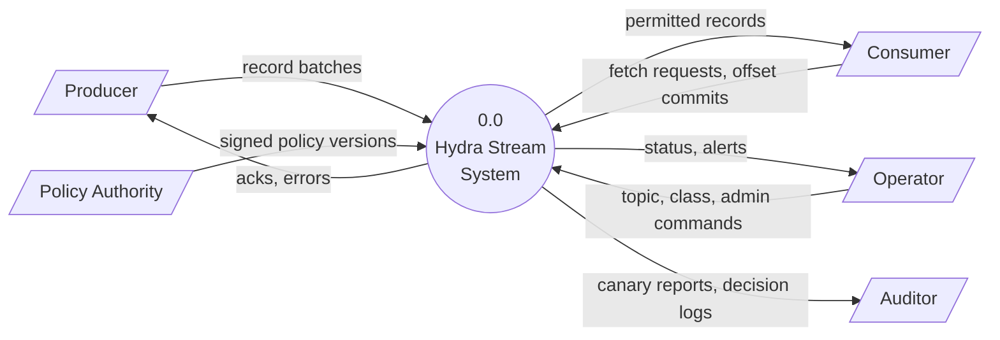

### 2.7.2 Level 1 — Major Processes

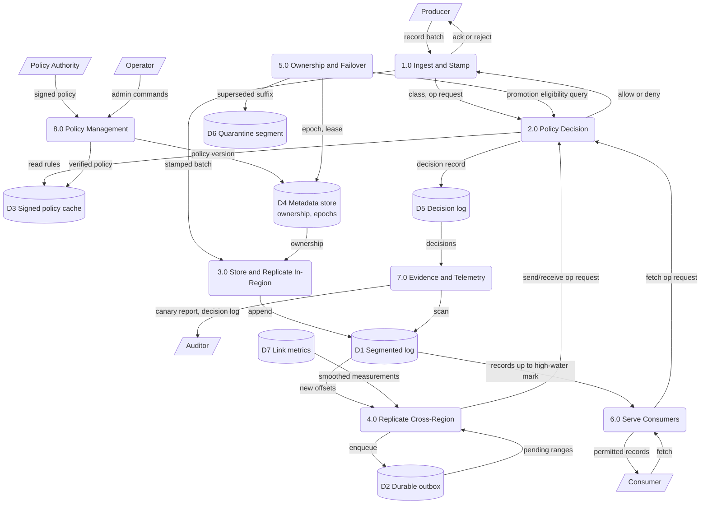

### 2.7.3 Level 2 — Process 4.0 Replicate Cross-Region

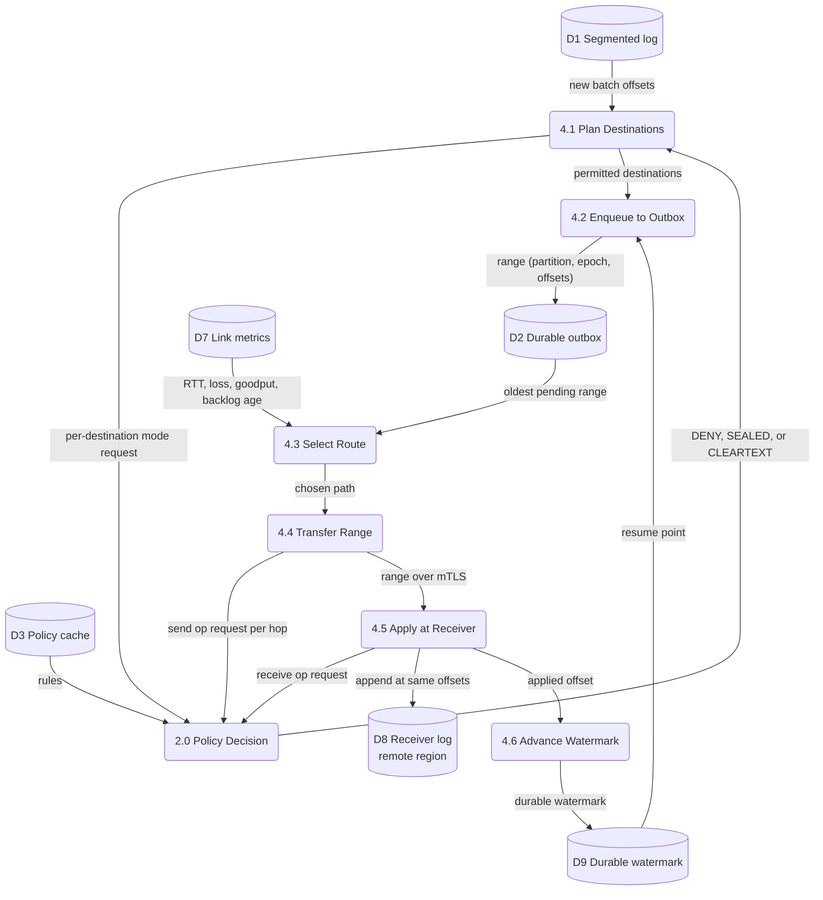

### 2.7.4 Level 3 — Process 4.3 Select Route

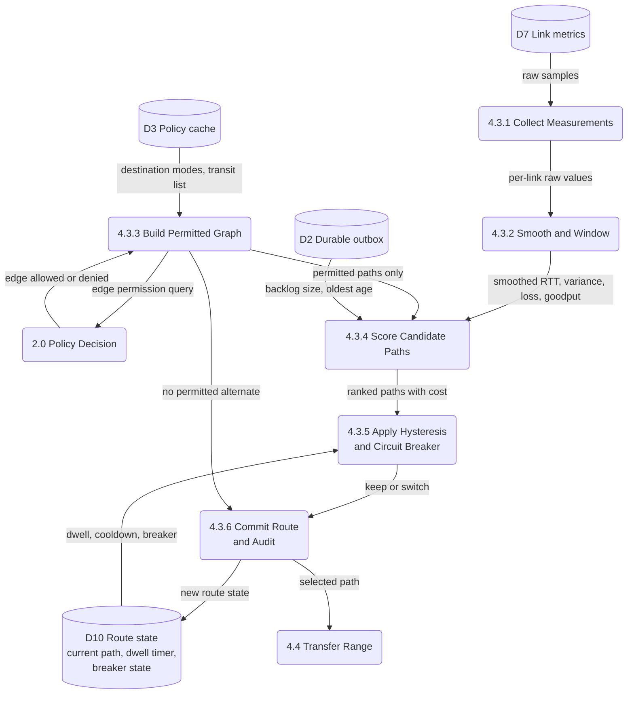

### 2.7.5 Level 3 — Process 2.0 Policy Decision

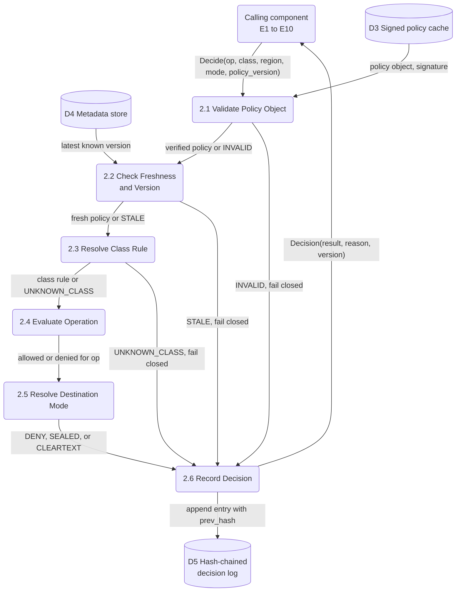

### 2.7.6 Level 3 — Process 5.0 Ownership and Failover

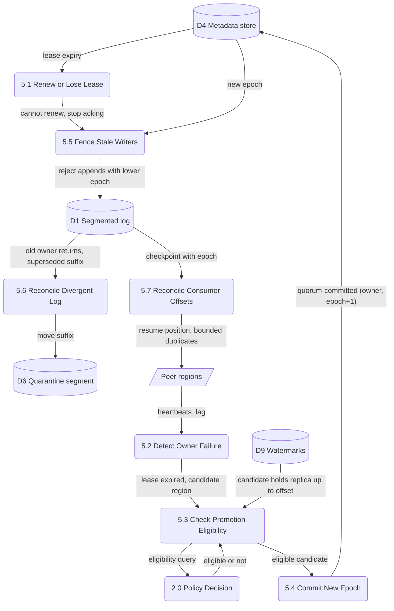

---

# Part 3 — Core Logic and Implementation

## 3.1 Sequence Diagrams

### 3.1.1 Produce Path with Policy Enforcement and Acknowledgment

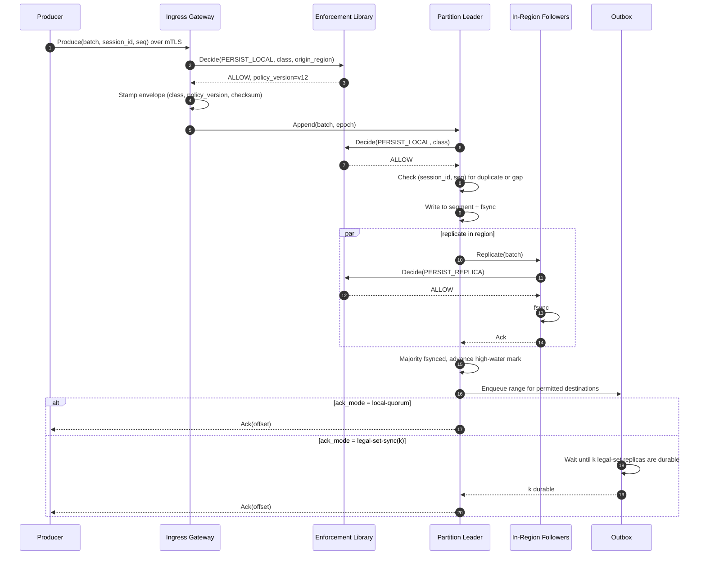

### 3.1.2 Cross-Region Replication with Durable Outbox and Resume

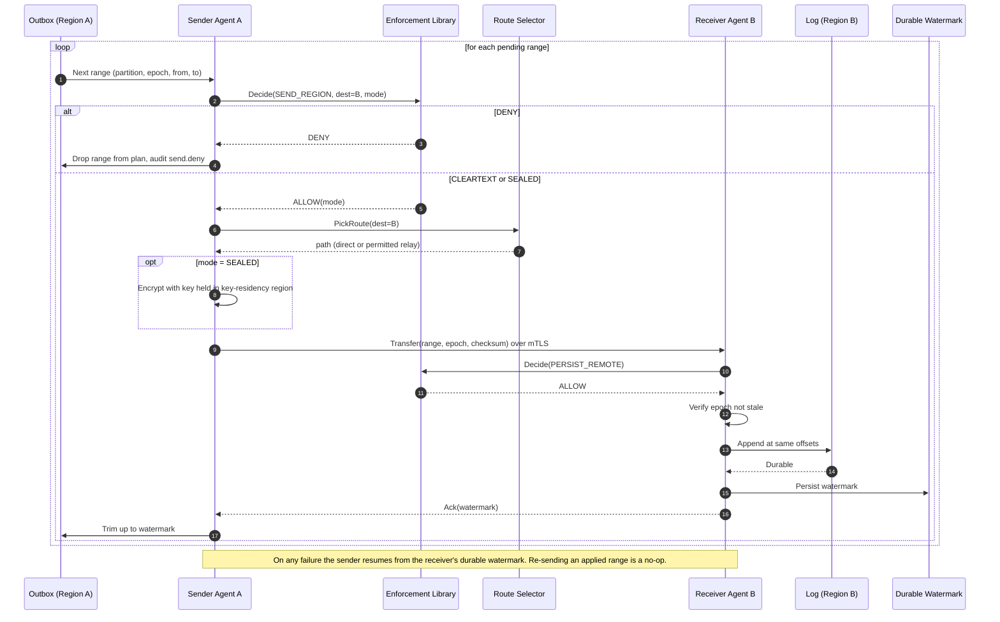

### 3.1.3 Regional Failover with Epoch Fencing

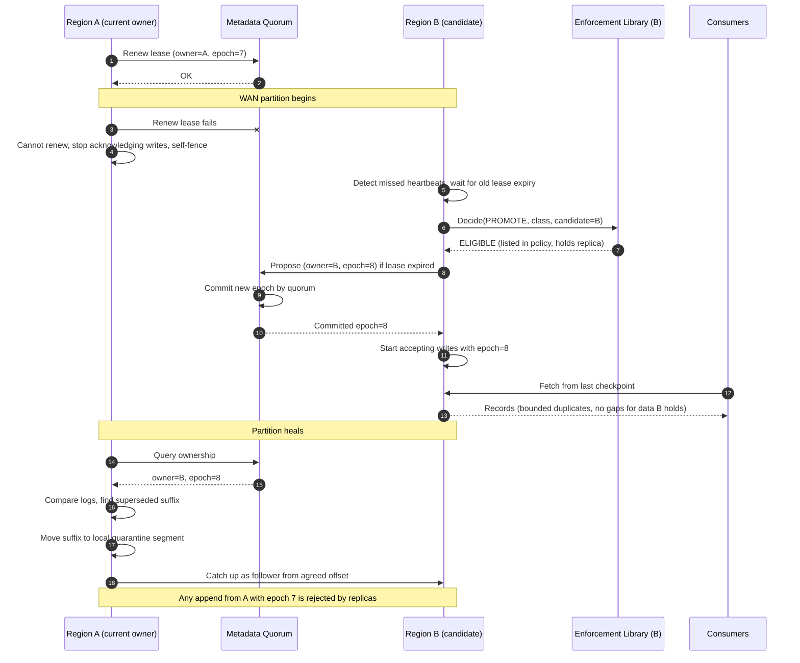

### 3.1.4 Adaptive Route Change with Hysteresis

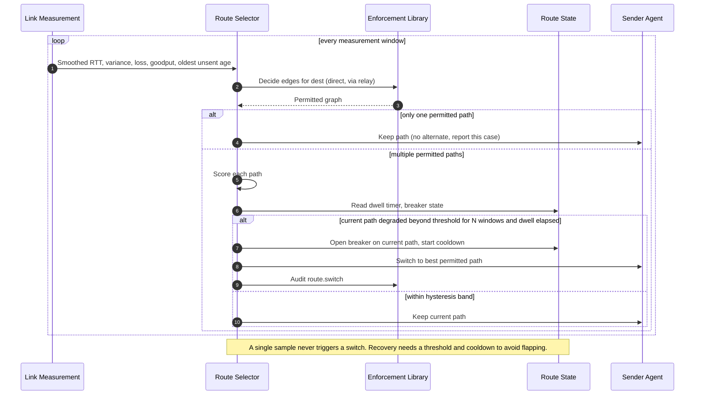

### 3.1.5 Signed Policy Distribution and Revocation

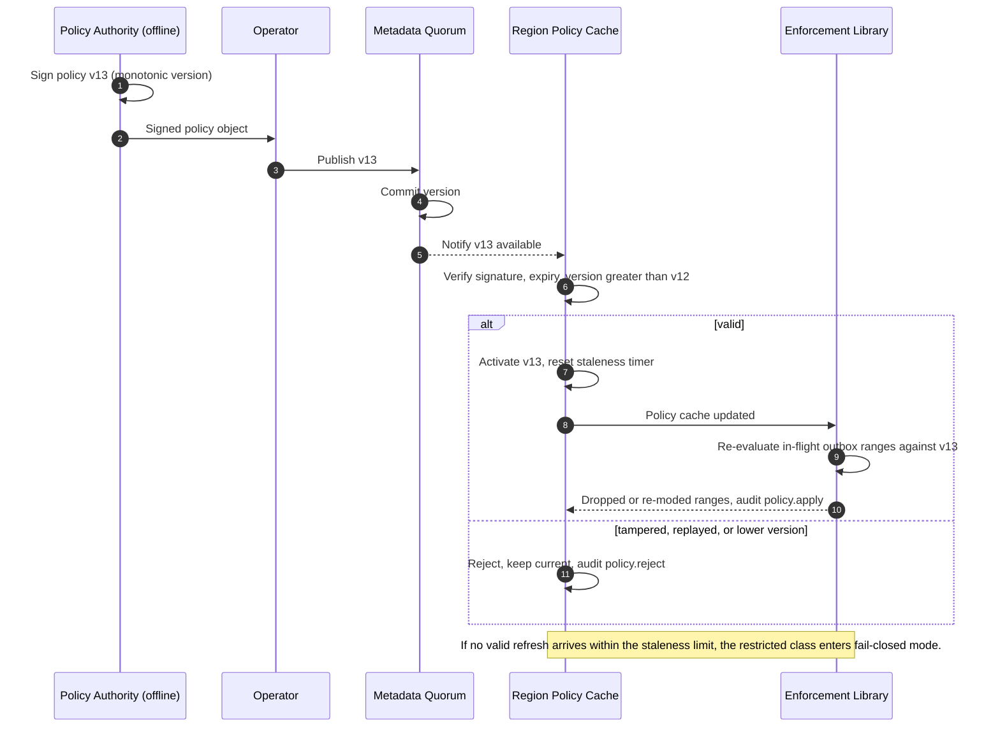

### 3.1.6 Sealed Copy Write and Key-Escrow Recovery

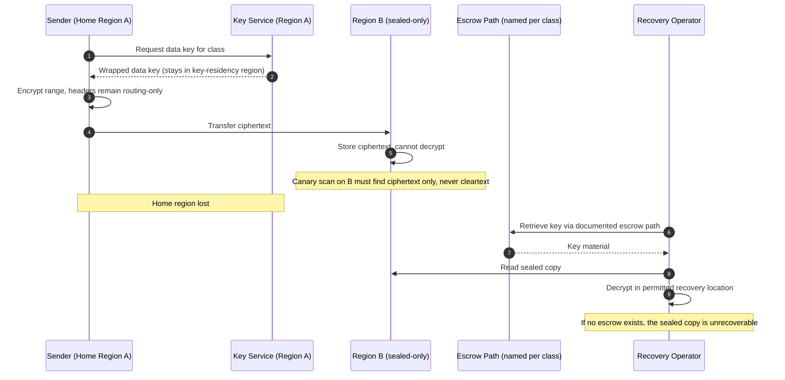

### 3.1.7 Canary Verification Run

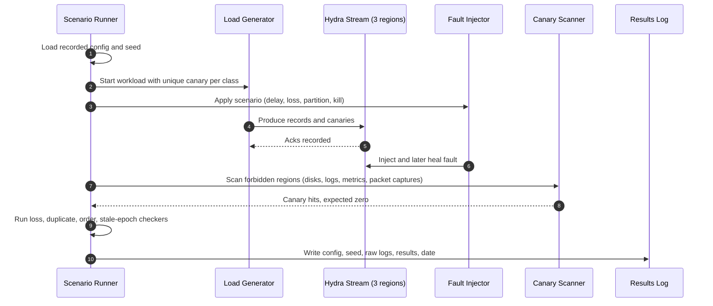

## 3.2 Logic Flowcharts

### 3.2.1 Central Decision Function

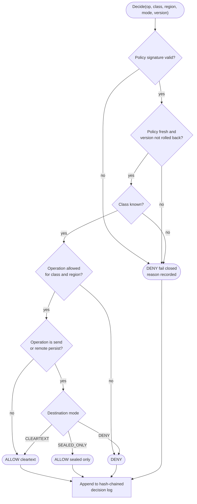

### 3.2.2 Route Selection

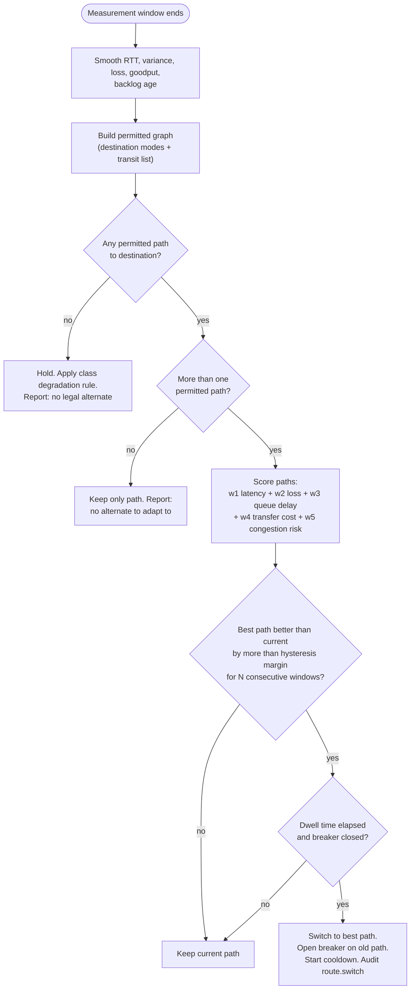

> Legal policy is a **hard filter** applied in step C. It is never a term in the score in step H.

### 3.2.3 Failover Promotion

```mermaid
flowchart TD
    A(["Heartbeats from owner missed"])
    B{"Old lease expired?"}
    C["Wait. Do not promote."]
    D{"Policy lists this region<br/>as eligible candidate?"}
    E["Refuse promotion. Class degrades<br/>per its rule"]
    F{"Candidate holds a replica<br/>for the partition?"}
    G["Refuse promotion"]
    H["Propose (owner=self, epoch+1)<br/>to metadata quorum"]
    I{"Quorum commits?"}
    J["Stay follower. Retry or give up."]
    K["Begin accepting writes<br/>with new epoch. Audit failover"]
    L["Replicas reject any append with lower epoch"]

    A --> B
    B -->|"no"| C
    B -->|"yes"| D
    D -->|"no"| E
    D -->|"yes"| F
    F -->|"no"| G
    F -->|"yes"| H --> I
    I -->|"no"| J
    I -->|"yes"| K --> L
```

### 3.2.4 Class Degradation When No Legal Destination Exists

```mermaid
flowchart TD
    A(["Replication to legal set blocked<br/>or no legal alternate region"])
    B{"Class backpressure rule"}
    C["Keep accepting local writes<br/>into bounded outbox"]
    D{"Outbox at disk bound?"}
    E["Block producers<br/>until space frees"]
    F["Reject writes with<br/>explicit error"]
    G["Continue until bound,<br/>then reject"]
    H["Other classes keep running<br/>unaffected"]

    A --> B
    B -->|"DEGRADE_LOCAL"| C --> D
    B -->|"BLOCK"| E
    B -->|"REJECT"| F
    D -->|"no"| C
    D -->|"yes"| G
    E --> H
    F --> H
    G --> H
```

### 3.2.5 Recovery of a Returning Old Owner

```mermaid
flowchart TD
    A(["Old owner A reconnects"])
    B["Read ownership from quorum:<br/>owner=B, epoch=8"]
    C{"A's local epoch<br/>lower than current?"}
    D["Continue as owner"]
    E["Self-fence: stop acking writes"]
    F["Find last offset agreed with new owner"]
    G{"A has records beyond<br/>the agreed offset?"}
    H["Move suffix to local quarantine segment<br/>(never replicated, never silently deleted)"]
    I["Truncate to agreed offset"]
    J["Catch up as follower from B"]
    K["Epoch auditor: scan for stale-epoch appends"]

    A --> B --> C
    C -->|"no"| D
    C -->|"yes"| E --> F --> G
    G -->|"yes"| H --> I
    G -->|"no"| I
    I --> J --> K
```

## 3.3 State Machines

### 3.3.1 Partition Ownership Lifecycle

```mermaid
stateDiagram-v2
    [*] --> Follower
    Follower --> Candidate: owner lease expired and policy eligible
    Candidate --> Owner: quorum commits epoch+1
    Candidate --> Follower: quorum rejects or ineligible
    Owner --> Fenced: lease renewal fails
    Owner --> Follower: higher epoch observed
    Fenced --> Follower: ownership read, superseded suffix quarantined
    Fenced --> Owner: lease renewed before expiry
    Follower --> [*]: partition deleted
```

### 3.3.2 Outbox Transfer

```mermaid
stateDiagram-v2
    [*] --> Pending
    Pending --> Planning: new range enqueued
    Planning --> Denied: policy DENY
    Planning --> Routing: policy ALLOW
    Routing --> Sending: path selected
    Sending --> AwaitingAck: bytes sent
    AwaitingAck --> Applied: receiver ack, watermark durable
    AwaitingAck --> Pending: timeout or failure, resume from watermark
    Applied --> [*]: trimmed from outbox
    Denied --> [*]: dropped from plan, audited
    Pending --> Backpressure: disk bound reached
    Backpressure --> Pending: space freed
```

### 3.3.3 Policy Freshness per Class

```mermaid
stateDiagram-v2
    [*] --> Fresh
    Fresh --> Fresh: valid newer version received
    Fresh --> Stale: staleness limit exceeded
    Stale --> FailClosed: restricted class
    Stale --> Fresh: valid refresh received
    FailClosed --> Fresh: valid refresh received
    Fresh --> Rejected: tampered or rolled-back object
    Rejected --> Fresh: keep current version, audit only
```

### 3.3.4 Route Circuit Breaker

```mermaid
stateDiagram-v2
    [*] --> Closed
    Closed --> Open: degradation sustained for N windows
    Open --> HalfOpen: cooldown elapsed
    HalfOpen --> Closed: recovery threshold met
    HalfOpen --> Open: probe fails
```

## 3.4 Reference Pseudocode

> Illustrative Go-style sketches. They define behaviour, not final code.

### 3.4.1 Decision Function

```go
type Result struct {
    Allow  bool
    Mode   DestMode // CLEARTEXT, SEALED_ONLY, DENY
    Reason string
}

func (e *Enforcer) Decide(req Request) Result {
    pol := e.cache.Current()

    switch {
    case !pol.Verify():
        return e.record(req, Result{false, DENY, "invalid_signature"})
    case !pol.IsFresh(e.clock.Now()) || pol.Version < e.cache.HighestSeen():
        return e.record(req, Result{false, DENY, "stale_or_rolled_back"})
    }

    rule, ok := pol.Class(req.Class)
    if !ok {
        return e.record(req, Result{false, DENY, "unknown_class"})
    }
    if !rule.Allows(req.Op, req.Region) {
        return e.record(req, Result{false, DENY, "not_in_legal_set"})
    }

    if req.Op == SEND_REGION || req.Op == PERSIST_REMOTE {
        switch rule.Destination(req.Region).Mode {
        case CLEARTEXT:
            return e.record(req, Result{true, CLEARTEXT, "ok"})
        case SEALED_ONLY:
            return e.record(req, Result{true, SEALED_ONLY, "ok_sealed"})
        default:
            return e.record(req, Result{false, DENY, "dest_denied"})
        }
    }
    return e.record(req, Result{true, CLEARTEXT, "ok_local"})
}
```

### 3.4.2 Idempotent Append

```go
func (l *Leader) Append(b Batch, epoch uint64) (Offset, error) {
    if epoch < l.epoch {
        return 0, ErrStaleEpoch // replicas reject lower epochs
    }
    st := l.sessions.Get(b.ProducerID)
    switch {
    case b.Seq == st.LastSeq:
        return st.LastOffset, nil // duplicate retry, no new append
    case b.Seq != st.LastSeq+1:
        return 0, ErrOutOfOrderSeq
    }
    off := l.segment.Write(b) // writes envelope with epoch, class, version
    l.segment.Fsync()
    l.replicateToMajority(b)
    st.Update(b.Seq, off)
    return off, nil
}
```

### 3.4.3 Route Scoring with Hard Policy Filter

```go
func (r *Router) Pick(dest Region, now Time) Path {
    graph := r.permittedGraph(dest) // calls Decide per edge, first
    if len(graph.Paths) == 0 {
        return NoPath // class degradation applies
    }
    if len(graph.Paths) == 1 {
        return graph.Paths[0]
    }

    best := graph.Paths[0]
    for _, p := range graph.Paths {
        c := W1*p.RTT + W2*p.Loss + W3*p.QueueDelay + W4*p.Cost + W5*p.CongestionRisk
        if c < p.cost(best) {
            best = p
        }
    }

    cur := r.state.Current(dest)
    if best == cur {
        return cur
    }
    if r.state.Wins(best, cur) >= N &&
        best.Cost < cur.Cost*(1-HysteresisMargin) &&
        now.Sub(r.state.LastSwitch(dest)) >= MinDwell &&
        r.state.BreakerClosed(cur) {
        r.state.Switch(dest, best, now)
        return best
    }
    return cur
}
```

### 3.4.4 Promotion

```go
func (n *Node) TryPromote(part PartitionID) error {
    own := n.meta.Ownership(part)
    if n.clock.Now().Before(own.LeaseExpiry.Add(n.maxClockDrift)) {
        return ErrLeaseNotExpired
    }
    d := n.enforcer.Decide(Request{Op: PROMOTE, Class: n.classOf(part), Region: n.region})
    if !d.Allow {
        return ErrNotEligible
    }
    if !n.holdsReplica(part) {
        return ErrNoReplica
    }
    // Commit through the metadata quorum. Fails if another region committed first.
    return n.meta.CompareAndSwapOwner(part, own.Epoch, Owner{Region: n.region, Epoch: own.Epoch + 1})
}
```

### 3.4.5 Outbox Resume

```go
func (s *Sender) Run(dest Region, part PartitionID) {
    for {
        wm := s.receiver.DurableWatermark(dest, part) // resume point
        rng := s.outbox.Next(dest, part, wm)
        if rng.Empty() {
            s.wait()
            continue
        }
        d := s.enforcer.Decide(Request{Op: SEND_REGION, Class: rng.Class, Region: dest})
        if !d.Allow {
            s.outbox.Drop(rng)
            continue
        }
        payload := s.seal(rng, d.Mode)
        path := s.router.Pick(dest, s.clock.Now())
        if err := s.transfer(path, payload); err != nil {
            continue // retry resumes from the receiver watermark, applied ranges are no-ops
        }
        s.outbox.TrimTo(s.receiver.DurableWatermark(dest, part))
    }
}
```

## 3.5 API and Record Envelope

### 3.5.1 gRPC Surface (Protobuf sketch)

```protobuf
syntax = "proto3";
package hydra.v1;

service Stream {
  rpc CreateTopic(CreateTopicRequest) returns (CreateTopicResponse);
  rpc Produce(ProduceRequest) returns (ProduceResponse);
  rpc Fetch(FetchRequest) returns (FetchResponse);
  rpc CommitOffset(CommitOffsetRequest) returns (CommitOffsetResponse);
  rpc ReadOffset(ReadOffsetRequest) returns (ReadOffsetResponse);
  rpc ListOwnership(ListOwnershipRequest) returns (ListOwnershipResponse);
}

message CreateTopicRequest {
  string topic = 1;
  string class_id = 2;
  uint32 partitions = 3;
}

message ProduceRequest {
  string topic = 1;
  uint32 partition = 2;
  uint64 producer_id = 3;
  uint64 sequence = 4;
  repeated bytes records = 5;
}

message ProduceResponse {
  uint64 base_offset = 1;
  uint64 epoch = 2;
  string error = 3;
}
```

### 3.5.2 Record Batch Envelope

| Field | Type | Purpose |
| --- | --- | --- |
| `partition_epoch` | uint64 | Fencing and stale-epoch audit |
| `producer_id`, `sequence` | uint64 | Idempotent dedupe |
| `class_id` | string | Selects the class rule |
| `policy_version` | uint64 | Traceability of the stamping policy |
| `base_offset`, `count` | uint64, uint32 | Dense monotonic offsets |
| `payload` | bytes | Records (never logged) |
| `checksum` | uint32 | Detect corrupt tail, truncated on recovery |

### 3.5.3 Core Invariants

| ID | Invariant | Checker |
| --- | --- | --- |
| INV-1 | Offsets are dense and monotonic per partition | Ordering checker |
| INV-2 | An acknowledged record is on a majority of in-region replicas | Loss checker |
| INV-3 | A new leader holds all acknowledged records | Loss checker after broker kill |
| INV-4 | A fetch never returns records beyond the committed high-water mark | API contract tests |
| INV-5 | Destination log is a prefix of the source log, offsets match exactly | Prefix and checksum check |
| INV-6 | Retrying an applied range is a no-op | Retry-storm tests |
| INV-7 | No two regions commit writes for the same partition and epoch | Stale-epoch auditor |
| INV-8 | No payload outside the legal set or sealed-only mode | Canary scanner |
| INV-9 | An unsigned, invalid or rolled-back policy is never applied | Tampered and replayed policy tests |

## 3.6 Repository and Module Layout

```text
hydra-stream/
├── README.md
├── project.md
├── LICENSE
├── api/
│   └── hydra/v1/stream.proto
├── cmd/
│   ├── hydra-broker/
│   ├── hydra-agent/          # replication sender and receiver
│   ├── hydra-meta/           # metadata voter
│   └── hydra-ctl/            # admin, policy publish
├── internal/
│   ├── log/                  # segmented log, index, recovery
│   ├── replica/              # in-region replication
│   ├── session/              # idempotent producer state
│   ├── enforce/              # single decision function (shared library)
│   ├── policy/               # signing, verification, versioning
│   ├── outbox/               # durable queue, watermark, resume
│   ├── route/                # measurement, graph, scoring, hysteresis
│   ├── own/                  # epochs, leases, fencing, quarantine
│   ├── seal/                 # sealed-copy encryption, key service (simulated)
│   ├── meta/                 # Raft wrapper
│   └── audit/                # hash-chained decision log
├── test/
│   ├── emulation/            # netns, tc/netem scripts
│   ├── scenarios/            # parameterized scenario definitions
│   ├── checkers/             # loss, duplicate, order, stale-epoch
│   ├── canary/               # canary generator and scanner
│   └── baselines/            # Kafka + MM2, Pulsar deployments
├── scripts/
│   └── run_scenario.sh       # one-command reproducible run
└── results/
    └── <run-id>/             # config, seed, raw logs, summary
```

---

# Part 4 — Validation, Risk and Delivery

## 4.1 Test Bed

- Three logical regions as containers or network namespaces on one host, with documented links.
- Delay, jitter, loss, bandwidth limits and partitions applied with standard Linux traffic control (`tc`, `netem`).
- Clock skew injected for lease tests.
- Every scenario is scripted and parameterized so any run is repeatable from its recorded configuration.
- **Calibration.** Measure achieved delay and bandwidth against configured values and publish the calibration.

```mermaid
flowchart LR
    CFG["Scenario config + seed"] --> RUN["Scenario runner"]
    RUN --> FI["Fault injector<br/>tc, netem, kill, clock skew"]
    RUN --> LG["Load generator"]
    LG --> SYS["Hydra Stream<br/>3 regions"]
    FI --> SYS
    SYS --> CHK["Checkers<br/>loss, duplicate, order, epoch"]
    SYS --> CAN["Canary scanner"]
    SYS --> MET["Metrics"]
    CHK --> RES[("results/run-id")]
    CAN --> RES
    MET --> RES
```

## 4.2 Scenario Matrix

| ID | Scenario | Primary evidence |
| --- | --- | --- |
| S1 | Baseline, all links healthy | Reference throughput, latency, zero leaks |
| S2 | Progressive bandwidth reduction | Lag growth, outbox depth, route behaviour |
| S3 | Increasing RTT and jitter | Latency percentiles, route switches |
| S4 | Random and burst packet loss | Retransmission, goodput, oscillation |
| S5 | Asymmetric link conditions | Direction-specific lag |
| S6 | WAN partition between two regions | Stale-epoch writes, RPO, duplicates |
| S7 | Full region outage | RTO, loss bound, per-class behaviour |
| S8 | Broker outage inside a region | No acknowledged record lost |
| S9 | Control-plane outage, regions healthy | Pinned classes still write |
| S10 | Recovery with replication backlog | Catch-up time, no gaps |
| S11 | Policy revocation or stricter policy during outage | Outbox re-evaluation, fail-closed |
| S12 | Unauthorized replication via alternate path, backup, log exporter, replay tool | Zero canary hits in forbidden regions |
| S13 | Mis-set producer replication list | Broker still refuses |
| S14 | Sealed copy canary and key-escrow drill (P1) | Ciphertext only, recovery works |
| S15 | Reroute through permitted relay and denied relay (P1) | Route accepted or denied, audited |

## 4.3 Failure Matrix

The dossier requires each case to specify allowed writes and reads, commit, replication, loss bound, duplicates, ordering, RPO, RTO and operator action. Values below are **design expectations to be measured**, not results.

| Failure case | Writes | Reads | Replication behaviour | Loss bound | Duplicates | Ordering | Operator action |
| --- | --- | --- | --- | --- | --- | --- | --- |
| **A isolated from control plane, healthy locally** | Pinned: continue. Movable: continue under valid lease until expiry, then fence | Local reads continue | Outbox continues on existing permitted routes | None for acked data under `legal-set-sync(k)`, lag-bounded under `local-quorum` | None | Per partition | Restore control plane |
| **A isolated from B, both have local producers** | Only the epoch owner writes. Non-owner rejects or buffers per class rule | Local | Queue in outbox, resume on heal | Lag-bounded under `local-quorum` | Possible after failover, bounded by checkpoint interval | Per partition within epoch | Confirm owner, heal link |
| **A completely lost** | Eligible candidate promoted after lease expiry. Single-region classes stop | Candidate serves data it holds | Candidate becomes source | `local-quorum`: records not yet replicated. `legal-set-sync(k)`: none for acked | Bounded by checkpoint interval | Per partition, new epoch | Verify eligibility, recover or accept loss for single-region classes |
| **B has lagging replica** | Continue. B is excluded from the ack set until caught up | Local | Catch-up from watermark | Lag-bounded | None | Preserved | Investigate lag |
| **Both regions believe they are primary** | Lower epoch fenced and rejected | Local | Superseded suffix quarantined | Stale writes quarantined, never merged silently | Possible | Higher epoch wins | Review quarantine segment |
| **Metadata quorum unavailable** | Pinned: continue. Movable: continue until lease expiry, then fence. No promotions | Local | Existing routes continue | As per ack mode | None new | Preserved | Restore quorum |
| **Policy update arrives during outage** | Applied on receipt. Staleness timer decides fail-closed | Per policy | Outbox ranges re-evaluated | Dropped ranges audited | None | Preserved | Confirm applied version |
| **Region recovers with divergent logs** | Returns as follower | Catch-up | Truncate to agreed offset, quarantine suffix | Quarantined records not replicated | Possible within bound | New owner's order | Inspect quarantine |
| **No legal alternate region exists** | Per class: block, reject or degrade-local until bound | Local | None possible | Not applicable | None | Preserved | Add capacity or change policy |

## 4.4 Metrics and Method

| Group | Metrics |
| --- | --- |
| Throughput | Messages per second, bytes per second |
| Latency | End-to-end P50, P95, P99 |
| Replication | Lag in time and offsets, outbox depth, oldest unreplicated record age |
| Recovery | Measured RPO and RTO per scenario |
| Correctness | Duplicate rate, loss rate, ordering violations, stale-epoch commits |
| Routing | Route switches, oscillation rate |
| Pressure | Backpressure duration, rejected writes |
| Resources | CPU, memory, disk I/O, network |
| Policy | Enforcement violations (target zero in the test matrix), audit completeness, time to detect violations |
| Availability | Control-plane availability, local data-plane availability |

**Method.** Fixed seeds, several repetitions per scenario, medians and spread reported, raw logs kept. Numeric targets are set only after the hardware and test conditions are established. **Targets are not results.**

**Checkers we write:** loss and duplicate checker, per-partition ordering checker, canary scanner for forbidden regions, epoch auditor for stale-epoch appends.

## 4.5 Baselines and Fairness Rules

Compared systems:

1. Kafka with local replication only
2. Kafka with MirrorMaker 2 using static flows
3. Pulsar geo-replication
4. Naive latency-only router
5. Policy-filtered static routing
6. Policy-filtered adaptive routing with hysteresis
7. Failover without fencing versus with fencing

**Fairness rules**

- Use identical topology, message size, partitions, retention, durability settings and network impairment.
- Record every setting and list differences that cannot be normalized.
- Do not tune baselines less than our own system.
- Where a baseline lacks a feature (for example a per-record server-side residency check), compare on measurable outcomes rather than listing the absence as a defect.
- Each baseline passes its own smoke test and a replication-lag measurement before any comparison run.

## 4.6 Hypotheses

| ID | Hypothesis | Test |
| --- | --- | --- |
| H1 | A hard policy filter followed by adaptive route scoring can improve replication latency under WAN degradation without increasing policy violations | S2 to S4, route comparison against static and latency-only routing |
| H2 | Region-local durable queues plus bounded backpressure preserve local ingestion during WAN outages without unbounded memory growth | S6, long outage with memory monitoring |
| H3 | Fencing epochs and explicit failover eligibility prevent two regions committing writes for the same partition in the tested partition scenarios | S6, S7, clock-skew tests, stale-epoch auditor |
| H4 | Policy checks at every payload movement boundary give an auditable zero-unauthorized-replication result in the tested scenarios | S12, S13, canary scans |
| H5 | Hysteresis and dampening reduce route oscillation while keeping lag below a defined bound | S3, S4, oscillation rate |

These are hypotheses. Test them and report counterexamples.

## 4.7 Threat Model and Risks

### 4.7.1 Threat Model

| Threat | Mitigation | Residual risk |
| --- | --- | --- |
| Gateway bypass by replication worker, backup job or replay tool | One enforcement library at all persist and send points | Scan covers observed locations only |
| Producer supplies a wrong replication list | Server-side enforcement ignores producer lists | None for tested path |
| Tampered or replayed policy | Offline signing, monotonic versions, verification in every region | Compromise of the signing authority |
| Stale policy during outage | Staleness limit, fail-closed for restricted classes | Availability loss for that class |
| Split brain after partition | Leases, epochs, quorum-committed promotion, fencing | Bounded clock drift assumption |
| Rerouting through a third region | Transit-allowed list, ciphertext-only relay | Small permitted graph limits adaptivity |
| Telemetry or audit logs becoming regulated data | Telemetry export policy, decision log stores decisions and versions, never payload | Operator misconfiguration |
| Compromised regional broker holding cleartext | Not defended by this design | Out of scope |
| Compromised global control plane | Control plane holds no payload, policy is signed, regions verify | Denial of service on promotions |

### 4.7.2 Risk Register

| ID | Risk | Likelihood | Impact | Mitigation | Owner |
| --- | --- | --- | --- | --- | --- |
| R1 | Scope too large for the event | High | High | Tier cut line, P2 removed from pitch if cut | Lead |
| R2 | Own broker has safety bugs | Medium | High | Crash, kill and ordering tests before any differentiator work | Storage |
| R3 | Rules forbid custom broker or require Kafka compatibility | Medium | High | Ask organizers, fallback to a substrate with a thin enforcement layer | Lead |
| R4 | Single-host emulation misleads | Medium | Medium | Calibration and ratio-based reporting | Test |
| R5 | Adaptive routing shows no gain under strict residency | High | Medium | Report cases with and without alternate path | Routing |
| R6 | Lease safety violated by clock drift | Low | High | Drift injection, conservative lease margins | Failover |
| R7 | Novelty claim overstated | Medium | High | Claims checklist, wording "in the documentation we reviewed" | Lead |
| R8 | Sealed copy key lost with home region | Medium | High | Name escrow path per class, key-escrow drill | Security |

## 4.8 Delivery Plan

Stages follow the dossier. **Baseline first, then differentiators.**

```mermaid
gantt
    title Hydra Stream delivery plan (relative weeks)
    dateFormat  YYYY-MM-DD
    axisFormat  W%W
    section Foundation
    Stage 1 Policy model and simulator          :s1, 2026-11-02, 7d
    Stage 2 Regional streaming MVP              :s2, after s1, 14d
    section Differentiators
    Stage 3 Sovereignty enforcement (P0)        :s3, after s2, 10d
    Stage 4 Adaptive replication and outbox     :s4, after s3, 10d
    Stage 5 Failure recovery and fencing (P0)   :s5, after s4, 10d
    section Proof
    Stage 6 Evaluation and baselines            :s6, after s5, 10d
    Demo script and claims review               :s7, after s6, 4d
```

**Baseline exit criteria (before any differentiator work)**

1. A region ingests, replicates in mirror mode and serves reads under healthy conditions with all checkers green.
2. Broker loss, network pause and process crash scenarios pass loss, duplicate and ordering checks.
3. The metadata quorum survives single-voter loss without losing committed state.
4. Baselines run on the same testbed and produce comparable lag measurements.
5. The scripted scenario runner reproduces a run from its recorded configuration.

**Shared engineering practices:** pin dependency versions and record licenses, run invariant checkers in CI on a small scenario set, write each component's failure behaviour down before testing it, keep a results log linking every number to a run, configuration and date.

**Cut line (first to last):** D7 derive mode → Kafka wire-protocol subset → D3 transit → D2 sealed mode → link measurement polish. P0 items are never cut.

## 4.9 Demo Script

Proposed five-minute presentation sequence; timings are a storyboard, not measured
execution durations. Every step must display its scope. The current frontend is
local simulation and is not a source of broker evidence.

| Time | Scope and action | Evidence and limitation |
| --- | --- | --- |
| 0:00 | **SIMULATED:** show the browser's logical regions and class examples | Browser state only; no connected broker, actual regional metrics or live canary dashboard |
| 0:45 | **LOCAL IMPLEMENTATION:** show `tests::test_multi_broker_replication_and_watermark_catchup` | In-process broker/log replication test in `cmd/kamish-broker/src/lib.rs`, included in the baseline; not independent regional quorum durability |
| 1:30 | **SIMULATED:** run the slow-link scenario in `scripts/run_demo.sh` | Tokio timer-based traversal from `developer_b_scenarios.rs`; no `tc/netem` is applied. The CLI benchmark's separate delay object is not wired to its workload |
| 2:15 | **LOCAL IMPLEMENTATION:** show `tests::test_broker_outbox_replication_filter` and the original policy probes | Selected configured local broker paths reject disallowed targets; this is not a scan of all storage/export locations |
| 3:00 | **LOCAL COUNTEREXAMPLE:** display the actual independent-owner probe failure | Both independent unregistered regions can ACK epoch one. Do not narrate a working regional promotion |
| 3:45 | **SIMULATED DESIGN ILLUSTRATION:** explain the proposed owner/reconciliation sequence | Label it unimplemented. No actual common-prefix truncation/quarantine/follower-rejoin claim |
| 4:30 | **EXECUTED BASELINE EVIDENCE:** show full probe output, including both failures | Original probes: 11 pass; extended: 4 pass / 2 fail at the recorded revision. Full history/canary evidence is future work |
| 5:00 | **EXECUTED BASELINE EVIDENCE:** show commands, revision and raw outputs | [Phase 0 baseline report](audit/phase0_baseline_2026-10-31_204424Z/REPORT.md). A configuration-driven distributed scenario runner is not yet implemented |

To rerun the two selected local broker tests from the repository root:

```bash
cargo test -p kamish-broker --lib tests::test_multi_broker_replication_and_watermark_catchup -- --exact --nocapture
cargo test -p kamish-broker --lib tests::test_broker_outbox_replication_filter -- --exact --nocapture
```

The baseline ran them as part of `cargo test --workspace`; these focused commands
are reproduction instructions. Actual transport impairment, calibration, leader
kill and history-checker demonstration require the later implementation/evidence
phases and a new run record before this storyboard can be upgraded.

## 4.10 Open Questions and Assumptions

### 4.10.1 Questions for Organizers

| # | Question | Why it matters |
| --- | --- | --- |
| Q1 | May we build on Kafka or Pulsar, or must the broker be built from scratch? | Decides whether components 1 to 4 are built or reused |
| Q2 | Is Kafka wire-protocol compatibility required? | P2 stretch becomes mandatory |
| Q3 | Is residency per record, per topic, per tenant or per class? | We assume per class |
| Q4 | Do metadata, offsets, metrics and logs fall under residency? | Affects telemetry and metadata design |
| Q5 | Are encryption and key location sufficient, or must the bytes stay resident? | Decides whether sealed mode is valid |
| Q6 | Target RPO and RTO and the delivery semantics expected across regions? | Sets acknowledgment-mode defaults |
| Q7 | Which jurisdictions or policy sets are in scope for the demo? | Avoids asserting a universal legal rule |

### 4.10.2 Assumptions Register

| # | Assumption | Type | Status |
| --- | --- | --- | --- |
| A1 | Region location is taken from infrastructure labels | Technical | Stated limit |
| A2 | Clock drift between nodes is bounded | Technical | Must be tested |
| A3 | Policy is a configured legal and business rule, not inferred from IP geolocation | Legal / technical | Adopted |
| A4 | Some regimes may prohibit out-of-border storage even when encrypted | Legal | Sealed mode is a configurable rule, not a compliance claim |
| A5 | Key service is a software simulation in the prototype | Technical | Stated limit |
| A6 | Production workload identity is out of scope | Technical | Stated limit |

## 4.11 Claims Checklist

Before submission, confirm:

1. Does each difference still exist in the final build (tier not cut)?
2. Is each "others do X" statement re-checked against current documentation, with version and date?
3. Does each "we do Y" claim have a test and a run log?
4. Is every guarantee stated with scope and mechanism?
5. Are limits written next to the claim, not in an appendix?

**Do not claim** legal compliance, global exactly-once delivery, zero data loss, or zero unauthorized replication without a precise scope, mechanism and test evidence.

## 4.12 References

| Source | Type | Use |
| --- | --- | --- |
| [Apache Kafka — Geo-Replication / MirrorMaker 2](https://kafka.apache.org/documentation/#georeplication) | Product docs | Baseline behaviour |
| [Apache Kafka — Cross-cluster data mirroring](https://kafka.apache.org/operations/geo-replication-cross-cluster-data-mirroring/) | Product docs | Operations reference |
| [KIP-382 — MirrorMaker 2.0](https://cwiki.apache.org/confluence/display/KAFKA/KIP-382%3A+MirrorMaker+2.0) | Design proposal | Offset sync background |
| [Apache Pulsar — Architecture](https://pulsar.apache.org/docs/next/concepts-architecture-overview/) | Product docs | Baseline architecture |
| [Apache Pulsar — Geo-replication](https://pulsar.apache.org/docs/next/administration-geo/) | Product docs | Baseline replication |
| [RFC 9000 — QUIC](https://www.rfc-editor.org/rfc/rfc9000.html) | IETF standard | Transport background |
| [RFC 8684 — Multipath TCP](https://www.rfc-editor.org/rfc/rfc8684.html) | IETF standard | Multipath background |
| [RFC 8446 — TLS 1.3](https://www.rfc-editor.org/rfc/rfc8446.html) | IETF standard | Transport security |
| [CloudEvents](https://github.com/cloudevents/spec) | Specification | Envelope interoperability |
| [AsyncAPI](https://www.asyncapi.com/docs/reference/specification/latest) | Specification | API description |
| [OpenTelemetry](https://opentelemetry.io/docs/) | Project docs | Telemetry, export controls |
| [Raft paper (Ongaro, Ousterhout)](https://raft.github.io/raft.pdf) | Research paper | Metadata consensus |
| [etcd Raft](https://github.com/etcd-io/raft) | Library | Reuse candidate |
| [GDPR official text](https://eur-lex.europa.eu/eli/reg/2016/679/oj) | Law | Only if EU data is in scope |
| [NIST Privacy Framework](https://www.nist.gov/privacy-framework) | Framework | Privacy risk background |

> For each source, record document version, publication date, status, requirements, assumptions and limitations. Confirm the current supported documentation version before implementation decisions. Separate legal text from engineering interpretation.

---

*End of document · Hydra Stream project documentation · Draft v0.1 · 31 Oct 2026*
